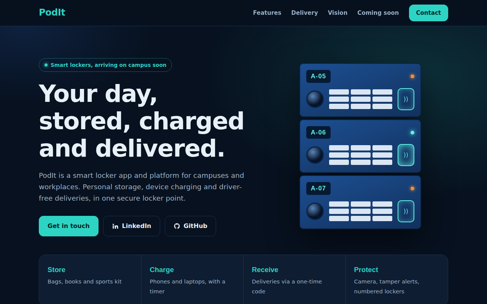
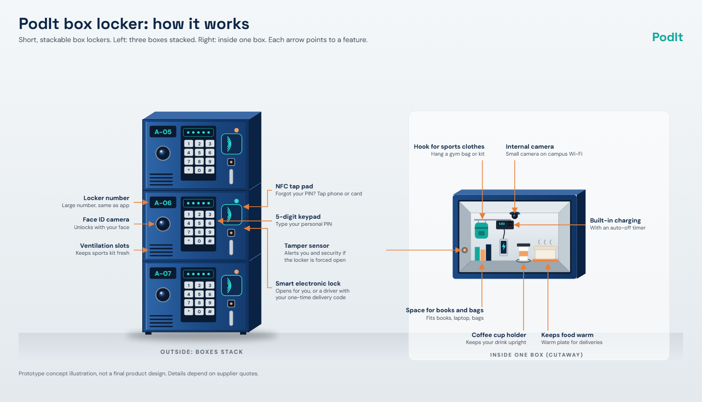

<div align="center">

# PodIt

**Smart lockers for campuses and workplaces.**
Store it. Charge it. Let the driver drop it off.




</div>

## About

PodIt is a smart locker app and platform for campuses and workplaces. Students rent a personal, stackable box locker to store bags, books and sports kit, charge their devices, and receive deliveries without leaving class.

This repository contains the **landing page** that introduces the project. The app and partnerships are **coming soon**.

> Built by **Abdelmawla Omara** as a student innovation project. The first planned deployment is on a university campus in the UAE.

## The idea

| Store | Charge | Receive | Protect |
|---|---|---|---|
| Bags, books and sports kit | Phones and laptops, with a timer | Deliveries via a one-time code | Camera, tamper alerts, numbered lockers |

**Smart delivery.** Instead of meeting the driver, the student creates a single-use code in the app and shares it with the order. The code opens only that drop-off locker, once, and never reveals the student's own PIN.

<p align="center">
  
</p>

<sub>Prototype concept illustration, not a final product design.</sub>

## Planned features

- Rent a personal locker through the app
- PIN access with large numbered lockers that match the app
- One-time delivery codes for drivers
- Built-in charging with an automatic timer
- Internal camera that records on events, plus tamper alerts
- Backup battery and offline PIN access for outages
- Later phases: NFC backup, Face ID, food warming

## Roadmap

- [x] Concept and documentation
- [ ] Student research (interviews and survey)
- [ ] Final design and app build
- [ ] Campus pilot
- [ ] Evaluation
- [ ] Expansion to other universities, offices, gyms and residential buildings

## Project structure

```
.
├── index.html            # Landing page (single page, no build step)
├── style.css             # Styles
└── assets/
    ├── how-it-works.png  # Concept illustration
    └── preview.png       # Screenshot used in this README
```

## Contact

**Abdelmawla Omara**, founder

- Phone: [+971 52 839 3921](tel:+971528393921)
- Email: [20260009102@students.cud.ac.ae](mailto:20260009102@students.cud.ac.ae)
- Email: [abdelmawlaomara2008@gmail.com](mailto:abdelmawlaomara2008@gmail.com)
- LinkedIn: [abdelmawlaomara](https://www.linkedin.com/in/abdelmawlaomara/)
- GitHub: [NewTechhh](https://github.com/NewTechhh)

## License

Copyright © 2026 Abdelmawla Omara. **All rights reserved.**
The PodIt name, concept, designs and written work are not licensed for reuse or redistribution without written permission.
